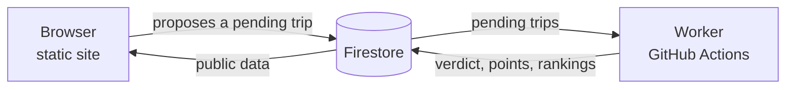

<p align="center">
  
</p>
<h1 align="center">BiciFastness</h1>
<p align="center">
  <b>Madrid is the circuit.</b> A competitive league built on everyday bike-share trips,<br>
  with verified results, divisions, clans and a territory map.
</p>
<p align="center">
  <a href="https://bicifastness.es"><b>bicifastness.es</b></a> ·
  <a href="#how-it-works">How it works</a> ·
  <a href="#verification">Verification</a> ·
  <a href="#development">Development</a> ·
  <a href="#documentation">Docs</a>
</p>
<p align="center">
  <a href="https://github.com/mateogsilvaa/bicifastness/actions/workflows/ci.yml"></a>
  
  
  
</p>

> Independent project. Not affiliated with, sponsored or endorsed by BiciMAD, EMT Madrid or Madrid City Council.
> The app and the detailed documentation are in Spanish.

## What it is

Riders upload a screenshot of a finished BiciMAD trip. A worker reads it, checks that it is genuine and turns it into
points. Speed is only one way to score:

| Mode | Rewards |
|---|---|
| **Sprint** | The best time on each route between two stations |
| **Endurance** | Kilometres accumulated over the season |
| **Consistency** | Active days and streaks |

Seasons, divisions, missions, clans and station control sit on top of those modes. The reasoning behind the rules is
in the [game design document](docs/JUEGO.md).

## How it works



**The browser can propose, never decide.** Firestore rules let a client create a trip only as `pending`. They do not
let it verify a trip, award points or grant a role. Those decisions belong to the worker, which runs with service
credentials.

## Verification

| Check | What it catches |
|---|---|
| Physical plausibility | A time that is impossible for the distance between the two stations |
| Internal consistency | Arrival minus departure does not match the displayed duration |
| Match with the claim | Stations or time that differ from what the rider declared |
| EXIF metadata | Traces of image editors |
| Exact and perceptual hashes | The same image resent, recompressed, cropped or resized |
| Competitive context | Records beaten by an implausible margin |

The signals add up to a risk score: low is approved, high is rejected, and the rest goes to human review. Text is read
with Tesseract and PaddleOCR. An optional vision model gives one more reading when reading is the only doubt. It never
rejects a trip, and its reading goes through the same checks.

## Tech stack

| Layer | Technology |
|---|---|
| Frontend | HTML, CSS and ES modules. No framework. Installable as a PWA |
| Data and auth | Firebase Auth and Firestore, with security rules as the access control |
| Worker | Node.js 20 on GitHub Actions, `sharp`, `tesseract.js`, PaddleOCR |
| Map | Leaflet and station GeoJSON |
| Hosting | GitHub Pages, deployed by CI |

## Development

```bash
git clone https://github.com/mateogsilvaa/bicifastness.git
cd bicifastness
npm install
npm install --prefix backend
npm run dev
```

`npm test` regenerates the shared data, then runs ESLint, page validation and the backend test suite.

Deploying your own instance needs a Firebase project. See the [setup guide](docs/PUESTA-EN-MARCHA.md).

## Project structure

| Path | Contents |
|---|---|
| `assets/` | Styles, browser modules and generated data |
| `backend/` | The worker, the verification engine and its tests |
| `firestore.rules` | Access control |
| `scripts/` | Data generation, site build and maintenance tools |
| `shared/`, `data/` | Source data shared by the frontend and the worker |
| `docs/` | Design, operation and maintenance guides |

## Documentation

| Document | Covers |
|---|---|
| [Game design](docs/JUEGO.md) | Rules, scoring and why they are that way |
| [Operation](docs/OPERACION.md) | Architecture, deployment and data model |
| [Setup](docs/PUESTA-EN-MARCHA.md) | Step-by-step launch |
| [Maintenance](docs/MANTENIMIENTO.md) | Routine checks and troubleshooting |
| [Roadmap](docs/ROADMAP.md) | What comes next |

## Author

Built by [Mateo González Silva](https://mateogsilvaa.es).
